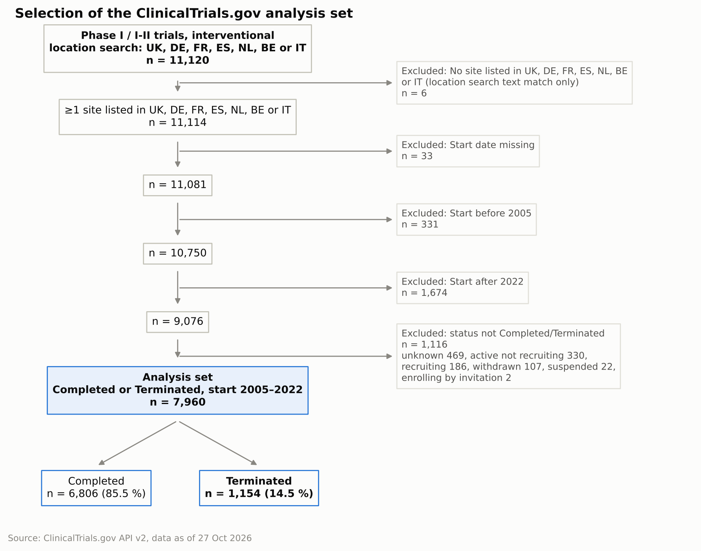
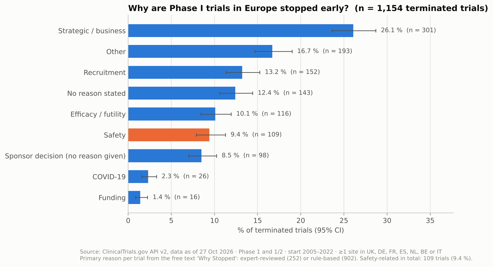
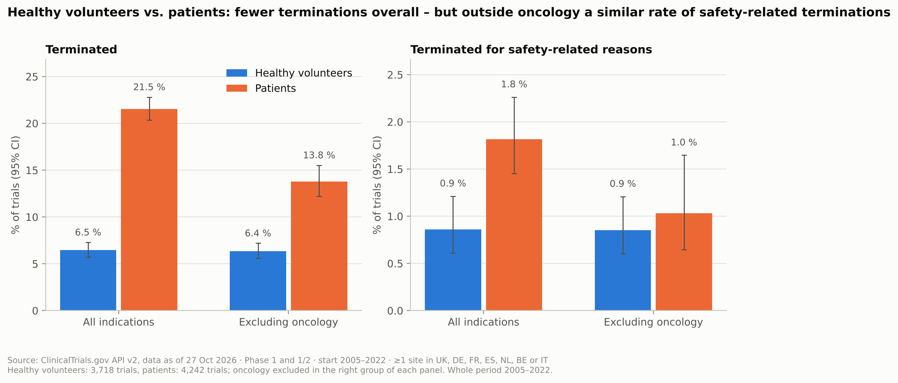
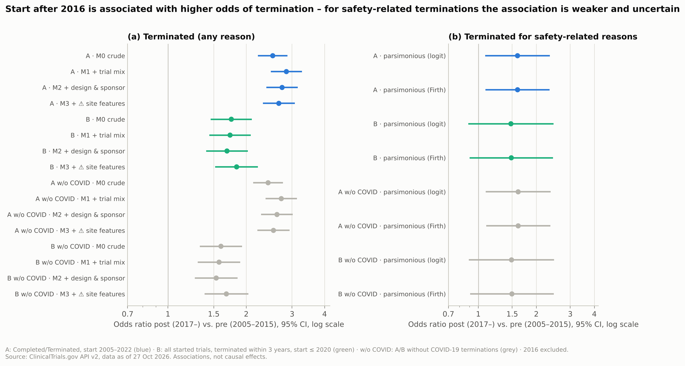
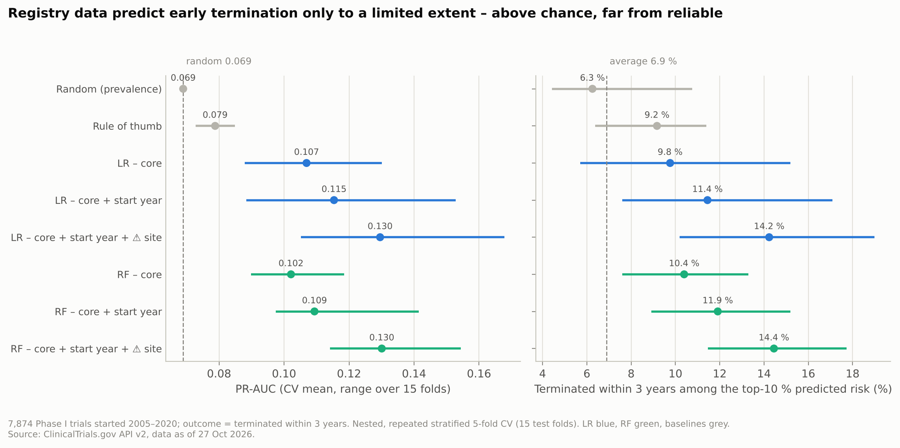
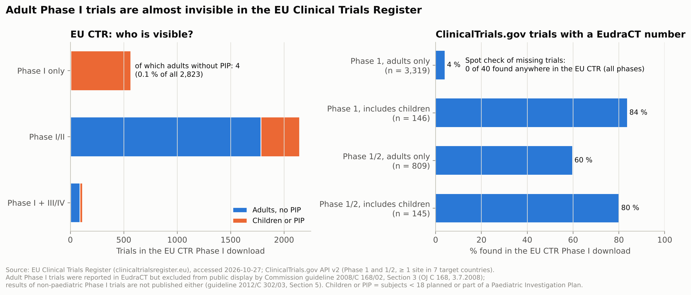
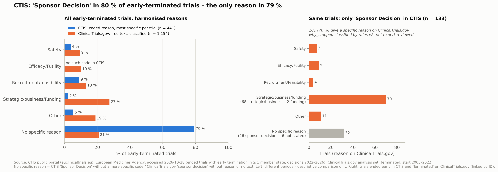
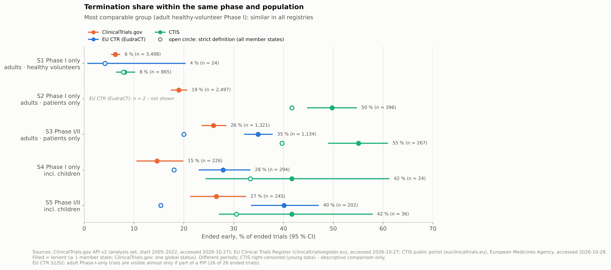
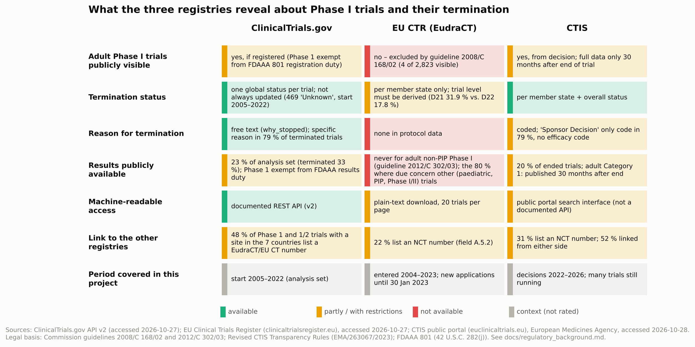

# Premature Termination of Phase I Trials in Europe

From TGN1412 (2006) and BIA 10-2474 (2016) to today's registries: how often are Phase I trials
in Europe stopped early, why, can it be predicted – and how much do the European registries
actually show?

**Author:** Wroud Mrae, Pharmacist (licensed in Germany) · independent portfolio project ·
data as of 27–28 October 2026

---

## Key findings

| | Finding | Number |
|---|---|---|
| 1 | Phase I trials stopped early (ClinicalTrials.gov, 7 European countries, start 2005–2022) | **14.5 %** (1,154 of 7,960) |
| 2 | Early stops due to safety | **9.4 %** of early stops = **1.4 %** of all trials |
| 3 | Most frequent reason | strategic / business 26.1 %; **no specific reason given 20.9 %** |
| 4 | Healthy-volunteer Phase I trials stop early rarely | **6–8 %** (ClinicalTrials.gov 6.3 %, CTIS 8.1 %) vs. 19 % in adult patient Phase I trials |
| 5 | Trials started after 2016 are more often terminated | adjusted OR 1.7–1.8 (fixed 3-year window), robust; **no robust change for safety-related stops** |
| 6 | Predicting early termination from registry data | **limited**: PR-AUC 0.11 vs. 0.07 by chance |
| 7 | Adult Phase I trials in the EU Clinical Trials Register | of 3,319 adult-only Phase 1 trials with a EudraCT number (ClinicalTrials.gov), only **131 (3.9 %)** appear in the public register – **none as adult Phase I** |
| 8 | CTIS coded termination reason | "Sponsor Decision" is the only code for **79 %** of early-terminated trials |

All shares are reported with 95 % Wilson confidence intervals in the notebooks; all associations are
**associations**, not causal effects.

---

## Background

Phase I trials are the first studies of a new medicine in humans. Two serious incidents shaped
European Phase I regulation:

- **TGN1412 (London, 2006):** six healthy volunteers developed a life-threatening cytokine storm
  within hours of the first dose of a CD28 super-agonist antibody [1]. Consequence: EMA guideline
  on first-in-human (FIH) clinical trials, in force from 1 September 2007 [3].
- **BIA 10-2474 (Rennes, 2016):** in the highest-dose cohort of a multiple-ascending-dose study of
  a FAAH inhibitor, one healthy volunteer became brain dead and others developed an acute
  neurological disorder, partly with lasting deficits [2]. Consequence: revised EMA FIH guideline
  (Rev. 1, 2017, in force from 1 February 2018) [4].

Premature termination is the visible end of such safety signals – but also of strategic decisions,
recruitment problems and futility. This project asks how often, and why, Phase I trials in Europe
stop early, with a special focus on **healthy-volunteer trials**, and how transparent the three
registries are.

## Research questions

1. **RQ1** – How many Phase I trials in Europe are terminated early, and how many for safety reasons?
2. **RQ2** – How does termination vary by indication, country, sponsor and year?
3. **RQ3** – Did anything change before vs. after 2016 (BIA 10-2474)?
4. **RQ4** – Can logistic regression or a random forest predict early termination; which features matter?
5. **RQ5** – How transparent are EudraCT (EU Clinical Trials Register) and CTIS compared with
   ClinicalTrials.gov?

## Data sources

| Registry | Role | Access | Accessed |
|---|---|---|---|
| ClinicalTrials.gov | main data set (RQ1–4) | documented REST API v2 | 27 Oct 2026 |
| EU Clinical Trials Register (EudraCT, Directive 2001/20/EC) | transparency (RQ5) | plain-text download, 20 trials per page | 27 Oct 2026 |
| CTIS (euclinicaltrials.eu, Regulation (EU) No 536/2014) | transparency (RQ5) | public search interface of the portal (not a documented API) | 28 Oct 2026 |

Only these three public registries are used. Attribution and terms of use:
[`docs/data_sources_and_terms.md`](docs/data_sources_and_terms.md). Raw exports are not part of
the repository; how to reproduce them: [`data/raw/README.md`](data/raw/README.md).

**Source attribution:** EU Clinical Trials Register (accessed 27 Oct 2026); CTIS public portal,
European Medicines Agency (accessed 28 Oct 2026); ClinicalTrials.gov, U.S. National Library of
Medicine (data as of 27 Oct 2026). The data are a **snapshot** and are not updated; for current
information see the registries themselves. Modifications of the registry data (selection,
recoding, classification of termination reasons, combination of country-level statuses) are
described under Methods and in the notebooks.

## Methods (short)

**Analysis set (ClinicalTrials.gov).** Interventional Phase 1 and Phase 1/2 trials with ≥ 1 site in
the UK, Germany, France, Spain, the Netherlands, Belgium or Italy, start 2005–2022, status
*Completed* or *Terminated*: **7,960 trials**.



**Why stopped (RQ1).** The free-text field `why_stopped` was classified with a rule-based classifier
(65 keyword patterns, negation handling, multi-label output, one primary reason by priority:
Safety > Efficacy/Futility > COVID-19 > Recruitment > Funding > Strategic/Business > Sponsor decision
(unspecified) > Other > Not stated).

- *Validation:* blinded, stratified sample of 218 texts rated by a domain expert (pharmacist),
  sampling weights for precision/recall: weighted agreement 83.9 %, kappa 0.80; safety precision
  78.1 % (78.8 % after documented expert corrections), safety recall 100 % (Clopper–Pearson lower
  bound 66 %). Official accuracy is reported for rule version v1; v2 was revised using the validation
  sample (optimistic: 90.9 %) and checked on a hold-out (only 6 changed texts – reported cautiously).
- *Final labels:* expert label where reviewed (252 trials), otherwise rules v2 (902 trials).
- *Expert labels (public):* all expert ratings – main review and hold-out (final and blinded
  first-round labels) and retest (original re-rating), with sample, stratum, sampling weight, primary
  reason, safety yes/no and the rules-v1 label, without registry texts – are in
  [`validation/expert_labels_public.csv`](validation/expert_labels_public.csv); the validation and
  test-retest figures above can be recomputed from this file (column descriptions:
  [`docs/data_dictionary.md`](docs/data_dictionary.md)).
- *Reliability:* **test-retest reliability of a single expert rater** (50 texts re-rated after a few
  days): kappa 0.78 (bootstrap 95 % CI 0.65–0.91) for the primary reason, 0.96 for safety yes/no. No
  second rater was available, so no inter-rater agreement can be reported; a memory effect may
  inflate the agreement.

**Statistics (RQ2–3).** Wilson CIs; logistic regression with step-wise adjustment for trial mix,
design and sponsor; Firth regression for rare outcomes; a **fixed 3-year observation window**
(start ≤ 2020) against right-censoring; sensitivity analyses (2-year window, worst case for
*Unknown* status, without retrospectively registered trials, without COVID-19 terminations,
interaction period × healthy volunteers).

**Prediction (RQ4).** Target: terminated within 3 years after start (7,874 trials started 2005–2020,
6.9 % positive). Only features known at the start of a trial. Logistic regression and random forest
with class weights; **nested repeated stratified cross-validation** (5 folds × 3 repeats, inner
grid search); PR-AUC as main metric with bootstrap CIs; recalibration; **temporal test**
(train 2005–2015 → test 2017–2020); permutation importance on the test folds.

**Registry transparency (RQ5).** EU CTR status per member state combined into one status per trial
with two definitions side by side (**D21 lenient:** prematurely ended in ≥ 1 country; **D22 strict:**
in all reporting countries); cross-registry matching by EudraCT, EU CT and NCT numbers; comparison
within the same phase and population strata and on the **same trials** in two registries.

## Results

### RQ1 – How often, and why?

1,154 of 7,960 trials were terminated (**14.5 %**, 95 % CI 13.7–15.3). **109 terminations
(9.4 %, 7.9–11.3) were safety-related, i.e. 1.4 % of all trials.**



Almost half of all terminations give no medical reason: strategic/business 26.1 %, no reason
stated 12.4 %, "sponsor decision" without a reason 8.5 %.

**Uncertainty of the non-safety categories.** Safety estimates are robust (every text the
algorithm labelled as safety was reviewed). The other categories rest on 60 randomly sampled
texts (weight 14.4 each) and are uncertain – e.g. *Efficacy/Futility* is 10.1 % in the final labels
but **15.3 %** in the weighted expert estimate of the validation sample.

### RQ2 – Who stops early?

- **Healthy volunteers vs. patients:** 6.5 % vs. 21.5 % terminated (excluding oncology 6.4 % vs.
  13.8 %) → not only an oncology effect. Safety-related terminations 0.9 % vs. 1.8 %, but 0.9 % vs.
  1.0 % excluding oncology → the safety difference is essentially an oncology effect.
- **Indication:** highest in oncology (26.0 %), lowest in trials without a target disease (5.2 %).
- **Country:** differences mainly reflect the trial mix (healthy-volunteer vs. multinational oncology
  trials), not national performance.
- **Sponsor:** industry and academic sponsors are similar crude (14.8 % vs. 13.7 %).



### RQ3 – Before vs. after 2016

Trials started 2017 or later were more often terminated than trials started 2005–2015: crude
OR 2.53; in the fixed 3-year window (no right-censoring) **adjusted OR 1.69–1.84**. The association
is robust in all sensitivity analyses and not explained by trial mix. **Safety-related**
terminations show **no robust change** (3-year window OR 1.48, 95 % CI 0.89–2.46). The period
effect does not differ robustly between healthy-volunteer and patient trials.



### RQ4 – Can early termination be predicted?

**Only to a limited extent.** Main model (decision D56): logistic regression with the core features
+ start year (no site/country features, because these may be updated after the start), recalibrated.

| Evaluation | Model | PR-AUC (95 % CI) | ROC-AUC | Terminated in top 10 % risk |
|---|---|---|---|---|
| Nested cross-validation¹ (prevalence 6.9 %) | **main model** (LR core + start year) | **0.109 (0.096–0.127)** | 0.64 | 11.4 % |
| | random forest core + start year | 0.106 (0.095–0.121) | 0.64 | 11.9 % |
| | *upper bound:* LR / RF + site features | 0.125 / 0.123 | 0.65 / 0.67 | 14.2 % / 14.4 % |
| | rule of thumb (oncology + healthy volunteers + Phase 1/2) | 0.078 (0.070–0.088) | 0.55 | 9.2 % |
| | chance | 0.069 (0.062–0.077) | 0.50 | 6.9 % |
| Temporal test 2005–2015 → 2017–2020 (prevalence 9.6 %) | main model (LR core + start year) | 0.126 (0.105–0.159) | 0.59 | 13.0 % |
| | random forest core + start year | 0.133 (0.111–0.162) | 0.62 | 14.3 % |
| | *upper bound:* random forest + site features | 0.169 (0.138–0.212) | 0.66 | 19.3 % |
| | rule of thumb (oncology + healthy volunteers + Phase 1/2) | 0.098 | 0.52 | 9.7 % |
| | chance | 0.096 | 0.50 | 9.2 % |

¹ Outer loop: stratified 5-fold cross-validation repeated 3 times (15 test folds); inner loop: grid
search. PR-AUC from the out-of-fold predictions (averaged over the repeats) with 1,000 bootstrap
resamples. After recalibration (sigmoid, inside the training folds) the main model has PR-AUC 0.110 –
recalibration hardly changes the ranking.

With the recalibrated main model, flagging the 10 % highest-risk trials finds 17 % of early
terminations at a precision of 11.5 % (per 1,000 trials: 12 correct, 89 false alarms). The
predicted probabilities are hardly more informative than the overall rate (Brier 0.063 vs. 0.064).

**Which features matter** (permutation importance on the test folds; odds ratios from the
unpenalised logistic regression):

- **Design** (randomised, double-blind, placebo-controlled vs. open): OR 2.02 (1.51–2.70).
- **Industry sponsor:** OR 1.91 (1.48–2.48). Why is there almost no crude difference in RQ2
  (14.8 % vs. 13.7 %)? Two reasons, both visible in the data: (1) the outcome differs – RQ2 counts
  termination at any time, the model counts termination **within 3 years**; academic trials are
  terminated later (median 3.3 vs. 2.4 years after start; 45 % vs. 59 % of their terminations
  within 3 years), so for *early* termination the crude difference is already 7.6 % vs. 4.7 %
  (OR 1.64). (2) Industry sponsors run far more healthy-volunteer trials (48 % vs. 28 %), which
  rarely stop early; adjusting for healthy volunteers alone raises the OR to 1.79.
- **Start year:** OR 1.05 per year.
- **Placebo** is associated with early termination mainly **within healthy-volunteer trials** (OR 3.83
  vs. 1.30 in patient trials). Placebo-controlled, FIH-like healthy-volunteer trials have the highest
  early-termination risk **within healthy-volunteer trials** (9.2 % vs. 3.0 %) – **not overall**:
  oncology trials are higher. A plausible explanation is the attrition of new compounds in randomised
  dose-escalation studies compared with open-label crossover PK/bioequivalence studies.



### RQ5 – How transparent are the European registries?

**EU Clinical Trials Register (EudraCT).** Adult Phase I trials were reported to the authorities but
deliberately **not published** (Commission guideline 2008/C 168/02, Section 3 [5]; results:
guideline 2012/C 302/03, Section 5 [6]). Of 2,823 Phase I trials in the register, only **4** are adult,
non-PIP, Phase-I-only trials. Of 3,319 adult Phase 1 trials on ClinicalTrials.gov with a EudraCT
number, 4 % appear in the register's Phase I list – and none as an adult Phase I trial; a random
sample of 40 missing trials was **not found anywhere** in the register (3/3 positive controls found).
The protocol data contain **no reason for termination**. The termination share depends strongly on
the definition: 31.9 % (D21, any country) vs. 17.8 % (D22, all countries).



**CTIS.** Adult Phase I trials are visible from the first decision, early terminations are published
immediately – but most details, the protocol and the results of adult Phase I trials only **30 months
after the end of the trial** (revised CTIS transparency rules, from 18 June 2024 [8]; legal basis
Article 81 of Regulation (EU) No 536/2014 [7]). The coded reason
is mostly uninformative: "Sponsor Decision" is the only code for 79 % of early-terminated trials. For
133 of these trials that are also *Terminated* on ClinicalTrials.gov, the free text there names a
specific reason for 101 (76 %; classified by rules v2, not expert-reviewed).



**Comparison within the same strata.** Overall shares are not comparable (EU CTR: mostly Phase I/II,
paediatric and PIP trials; ClinicalTrials.gov: mostly Phase-I-only, half of them in healthy
volunteers). Within the same phase and population the gap shrinks; for the **same 542 trials** in
both registries, ClinicalTrials.gov *Terminated* (30.6 %) matches the lenient EudraCT definition
(32.8 %). Healthy-volunteer Phase I trials stop early rarely in every registry with enough data
(6.3 % ClinicalTrials.gov, 8.1 % CTIS).





CTIS shares are higher in all patient strata – consistent with **right-censoring** of young data
(decisions 2022–2026: short healthy-volunteer trials have already ended, long patient trials have
mostly not; those that ended are enriched for early stops). The CTIS comparison of healthy volunteers
(8 %) vs. patients (51 % among *ended* trials) is therefore only shown together with the status
distribution and the share among all trials (6 % vs. 20 %).

## Limitations

The full list is in [`docs/limitations.md`](docs/limitations.md). Most important:

- **Registered trials only.** Phase 1 trials are exempt from the US registration duty (FDAAA 801);
  in the EU, adult Phase I trials were not public before CTIS. In CTIS only 24 % of the
  healthy-volunteer Phase I trials have an NCT number → ClinicalTrials.gov covers European
  healthy-volunteer trials only partially.
- **Selective registration.** 10.6 % of completed but only 2.7 % of terminated trials were registered
  after their primary completion date → the true termination share is probably **higher** than the
  visible one.
- **Reason classification.** Rule-based, validated by **one** expert (test-retest reliability of a
  single expert rater, no inter-rater agreement); non-safety categories uncertain (see RQ1).
- **Right-censoring** in young data (CTIS, ClinicalTrials.gov 2020–2022); addressed with a fixed
  3-year window but not removable in CTIS.
- **Status definitions differ** between registries (one global status vs. per member state); status
  fields are not always updated (469 trials with status *Unknown*).
- **CTIS data access** via the portal's public search interface, which may change; downloaded on
  28 October 2026.
- All results are **associations**; no causal conclusions.

## Repository structure

```
phase1-terminations-europe/
├── data/
│   ├── raw/          # registry exports (not committed; see data/raw/README.md)
│   ├── interim/      # flattened registry data (not committed)
│   └── processed/    # analysis data sets and result tables
├── mappings/         # indication groups, termination-reason keywords (v1 frozen, v2), CTIS status mapping
├── validation/       # expert labels (expert_labels_public.csv), validation metrics and corrections
├── notebooks/        # 01–07, run in order; helper modules viz_style.py, review_import.py, why_stopped_rules.py
├── figures/          # figures 01–17 for the README
├── linkedin/         # six figures for the LinkedIn post (1080 × 1350 px)
└── docs/             # project log (decisions D01–D70), data dictionary, limitations,
                      # regulatory background, data sources and terms of use
```

| Notebook | Content |
|---|---|
| `01_data_acquisition_and_checks` | download of the three registries, completeness checks |
| `02_cleaning_and_features` | analysis set, flow diagram, features (leakage check), indication groups |
| `03_why_stopped_classification` | rule-based classifier, blinded validation, final labels, test-retest |
| `04_descriptive_analysis` | RQ1–2 |
| `05_pre_post_2016` | RQ3, sensitivity analyses |
| `06_modeling` | RQ4 |
| `07_registry_transparency` | RQ5: EudraCT, CTIS, comparison of the three registries |

## Reproducibility

```bash
python -m venv .venv
.venv/bin/pip install -r requirements.txt
cd notebooks
../.venv/bin/jupyter nbconvert --to notebook --execute --inplace 01_data_acquisition_and_checks.ipynb
# … then 02 to 07 in order
```

**Note on the published version:** raw registry exports, trial-level data sets and the review
files with registry free texts are not published (terms of use, see
[`docs/data_sources_and_terms.md`](docs/data_sources_and_terms.md)). Notebook 01 re-creates the
raw data by downloading them again; notebook 03 additionally needs the filled-in review files,
and notebooks 04–07 build on its output. All results remain visible in the executed notebooks,
and the expert labels are published in `validation/expert_labels_public.csv`.

Notebook 01 downloads the registries with polite pauses between requests (about 1–2 hours in
total); later notebooks read the files it writes. Raw files that already exist in `data/raw/` are
reused, not downloaded again. Registry content changes over time, so a new download can give
slightly different numbers; the access dates of this analysis are given above.

**Offline re-run from the saved raw data.** To re-run all notebooks without any network access
(only the raw files already saved in `data/raw/`), set the environment variable
`PHASE1_OFFLINE=1`:

```bash
export PHASE1_OFFLINE=1
cd notebooks
for nb in 01_data_acquisition_and_checks 02_cleaning_and_features 03_why_stopped_classification \
          04_descriptive_analysis 05_pre_post_2016 06_modeling 07_registry_transparency; do
  ../.venv/bin/jupyter nbconvert --to notebook --execute --inplace --ExecutePreprocessor.timeout=-1 "$nb.ipynb"
done
```

In this mode `notebooks/offline_guard.py` blocks every network connection, so a missing raw file
causes an error instead of a new download; notebook 01 takes the EU CTR search counts from the
saved metadata file (decision D70). A full offline re-run on 11 Nov 2026 (about 20 minutes)
reproduced all data files, figures and README numbers.

Every decision is documented with its reason in [`docs/project_log.md`](docs/project_log.md)
(D01–D70).

## How this project was made

The analysis code (data download, notebooks, figures) was written with the support of
**Claude Code** (Anthropic). The research questions, the study design, all methodological
decisions (documented as D01–D70 in the project log), the blinded expert review of the
termination reasons (218 texts, hold-out and test-retest) and the interpretation of the results
are the author's own work.

## Disclaimer

Independent analysis of public registry data for educational and portfolio purposes. Not medical,
legal or regulatory advice. Registry data are supplied by sponsors and authorities; their
completeness and accuracy are the responsibility of the data providers.

## License

- **Code:** MIT License (see [`LICENSE`](LICENSE)).
- **Figures and texts** (README, figures, LinkedIn graphics): © 2026 Wroud Mrae, licensed under
  [CC BY 4.0](https://creativecommons.org/licenses/by/4.0/) – reuse with attribution (see
  [`LICENSE-CC-BY-4.0.txt`](LICENSE-CC-BY-4.0.txt)).
- **Registry data** remain subject to the terms of the respective registries (see
  [`docs/data_sources_and_terms.md`](docs/data_sources_and_terms.md)); the source attributions on
  the figures must be kept when they are reused.

## References

1. Suntharalingam G, Perry MR, Ward S, et al. Cytokine storm in a phase 1 trial of the anti-CD28
   monoclonal antibody TGN1412. *N Engl J Med* 2006;355(10):1018–28.
   doi:[10.1056/NEJMoa063842](https://doi.org/10.1056/NEJMoa063842). PMID 16908486.
2. Kerbrat A, Ferré JC, Fillatre P, et al. Acute neurologic disorder from an inhibitor of fatty acid
   amide hydrolase. *N Engl J Med* 2016;375(18):1717–25.
   doi:[10.1056/NEJMoa1604221](https://doi.org/10.1056/NEJMoa1604221). PMID 27806235.
3. European Medicines Agency. Guideline on strategies to identify and mitigate risks for
   first-in-human clinical trials with investigational medicinal products. EMEA/CHMP/SWP/28367/07,
   legal effective date 1 September 2007.
4. European Medicines Agency. Guideline on strategies to identify and mitigate risks for
   first-in-human and early clinical trials with investigational medicinal products.
   EMEA/CHMP/SWP/28367/07 Rev. 1, legal effective date 1 February 2018.
   [EMA guideline page](https://www.ema.europa.eu/en/scientific-guidelines/strategies-identify-mitigate-risks-first-human-early-clinical-trials-investigational-medicinal-products)
5. European Commission. Communication from the Commission regarding the guideline on the data
   fields contained in the clinical trials database provided for in Article 11 of Directive
   2001/20/EC to be included in the database on medicinal products provided for in Article 57 of
   Regulation (EC) No 726/2004 (2008/C 168/02). *OJ C 168*, 3.7.2008, p. 3.
6. European Commission. Commission Guideline – Guidance on posting and publication of
   result-related information on clinical trials in relation to the implementation of Article 57(2)
   of Regulation (EC) No 726/2004 and Article 41(2) of Regulation (EC) No 1901/2006 (2012/C 302/03).
   *OJ C 302*, 6.10.2012, p. 7–10.
   [EUR-Lex](https://eur-lex.europa.eu/legal-content/EN/TXT/?uri=CELEX:52012XC1006(01))
7. Regulation (EU) No 536/2014 of the European Parliament and of the Council of 16 April 2014 on
   clinical trials on medicinal products for human use, and repealing Directive 2001/20/EC.
   *OJ L 158*, 27.5.2014, p. 1–76.
8. European Medicines Agency. Revised CTIS Transparency Rules. EMA/263067/2023, adopted by the EMA
   Management Board on 5 October 2023, applicable from 18 June 2024.
   [PDF](https://www.ema.europa.eu/en/documents/other/revised-ctis-transparency-rules_en.pdf)

Further regulatory sources (Paediatric Regulation, CTIS historical-trial rules, FDAAA 801):
[`docs/regulatory_background.md`](docs/regulatory_background.md).

